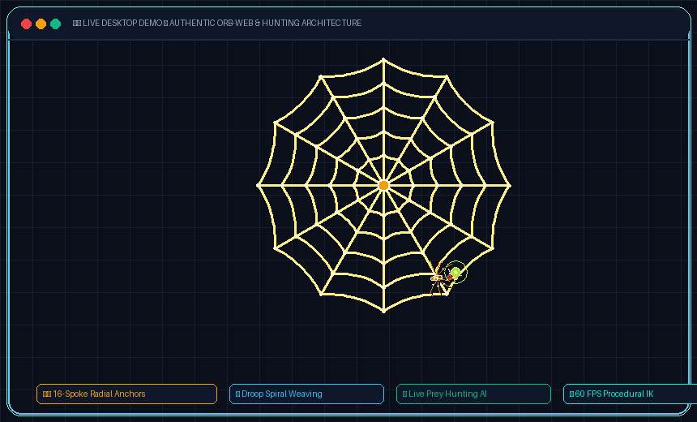

# 🌌 Desktop Floating (ডেস্কটপ ফ্লোটিং — Living Desktop Companions)

<p align="center">
  
  
  
  
  
</p>

An ultra-responsive, physics-driven, living **Desktop Floating Companion Ecosystem** designed for **Windows 10/11**, **Linux**, and **macOS**.

Currently featuring the **Procedural Cyber Spider** (with genuine orb-web weaving) and the **Graceful Fluttering Butterfly** (with full caterpillar-to-butterfly metamorphosis), alongside an active roadmap of upcoming desktop companions!

The transparent overlay runs silently and non-intrusively across your active wallpaper, browser, code editors, and full-screen media with **100% transparent click-through mechanics (`WS_EX_TRANSPARENT`)**, zero taskbar clutter, 24/7 system tray controls, a sleek dark-glass live settings customizer (`Shift + P`), and an integrated **GitHub Auto-Updater with real-time Megabyte (MB) download progress**!

---

## 🖥️ Live Desktop Demo & Visual Showcase (ভিজ্যুয়াল ডেক্সটপ ডেমো)

### 🕷️ Authentic Live Spider & Web Architecture on Desktop
<p align="center">
  
</p>

### 🎨 Companion Ecosystem Vector Simulation
<p align="center">
  
</p>

> **💡 Zero Desktop Interference**: All companions float seamlessly over your wallpaper, code editors, games, and YouTube videos without intercepting mouse clicks, dragging, or keystrokes!

---

## 💻 Terminal & Command Prompt Experience

When you launch `desktop-floating` in your terminal (CMD / PowerShell / Bash / Zsh), it greets you with an illuminated glowing cyber banner and instant quick-reference hotkeys:

```text
  ███████╗██╗      ██████╗  █████╗ ████████╗██╗███╗   ██╗ ██████╗ 
  ██╔════╝██║     ██╔═══██╗██╔══██╗╚══██╔══╝██║████╗  ██║██╔════╝ 
  █████╗  ██║     ██║   ██║███████║   ██║   ██║██╔██╗ ██║██║  ███╗
  ██╔══╝  ██║     ██║   ██║██╔══██║   ██║   ██║██║╚██╗██║██║   ██║
  ██║     ███████╗╚██████╔╝██║  ██║   ██║   ██║██║ ╚████║╚██████╔╝
  ╚═╝     ╚══════╝ ╚═════╝ ╚═╝  ╚═╝   ╚═╝   ╚═╝╚═╝  ╚═══╝ ╚═════╝
                 D E S K T O P   F L O A T I N G

  ✨ Living Cyber Pet Ecosystem (Spider 🕷️, Butterfly 🦋, and more!)
  ⚡ Version: 1.0.0 | Author: Sohag Haldar | License: MIT
  ----------------------------------------------------------------------
  🎮 QUICK SHORTCUTS:
     [Shift + M] Switch Companion (Spider ↔ Butterfly)
     [Shift + P] Open Live Settings & Customizer
     [Shift + F] Spawn Prey Fly / Fresh Leaf
     [Shift + B] Bungee Jump (Spider) / Stardust Burst (Butterfly)
     [Shift + T] Cycle Cyber Color Themes
     [Shift + `] Relocate Web / Cocoon Anchor
     [Shift + ESC] Safely Exit Pet & Application
  ----------------------------------------------------------------------
```

If an instance is already active on your desktop, running `desktop-floating` in CMD alerts you without launching duplicates, guiding you directly to your hotkeys and system tray controls.

---

## 🐾 Living Companions Showcase (প্রাণীসমূহ)

<table>
  <tr>
    <td width="50%" valign="top">
      <h3>🕷️ 1. Silk Arachnid (সাইবার স্পাইডার)</h3>
      <p><b>Status:</b> <code>Active & Ready</code> | <b>Type:</b> <code>Physics Simulation</code></p>
      <ul>
        <li><b>Procedural Inverse Kinematics (IK) Legs:</b> 8 independently calculated jointed legs that naturally grip screen boundaries and web strands with organic stepping phases.</li>
        <li><b>Authentic Orb-Web Weaving:</b> Procedural ceiling silk anchors, radial spoke construction, and concentric spiral threads with dewdrop weight physics.</li>
        <li><b>Interactive Hunting:</b> Playfully crawls toward resting mouse cursors, delivers soft playful nudges, hunts flying flies, and performs silk bungee drops (<code>Shift + B</code>).</li>
        <li><b>Spiderling Nursery:</b> Hatch dozens of tiny baby spiderlings that ride on the mother's back (<code>Shift + H</code>).</li>
      </ul>
    </td>
    <td width="50%" valign="top">
      <h3>🦋 2. Fluttering Butterfly (প্রজাপতি ও শুঁয়োপোকা)</h3>
      <p><b>Status:</b> <code>Active & Ready</code> | <b>Type:</b> <code>Biological Lifecycle</code></p>
      <ul>
        <li><b>Full Metamorphosis:</b> Begins as an inchworm caterpillar crawling smoothly across screen edges and window frames.</li>
        <li><b>Silky Cocoon Spinning:</b> Spins an organic silk cocoon anywhere on your monitor (<code>Shift + `</code>).</li>
        <li><b>Aerodynamic Flapping Flight:</b> Emerges with dual-winged flight aerodynamics, smooth velocity gliding, and luminous stardust fairy particle trails (<code>Shift + B</code>).</li>
        <li><b>Natural Attraction:</b> Drifts toward your active cursor and perches gracefully on resting windows.</li>
      </ul>
    </td>
  </tr>
</table>

### 🔮 3. Upcoming Companions Expansion Roadmap (পরবর্তী প্রাণীসমূহ)
Desktop Floating is built on an extensible creature engine. New companions will be introduced through seamless auto-updates:

* 🦚 **Royal Crested Bird & Chick Nest**: High-altitude branch/nest building, parent-chick feeding, and flocking glide flight.
* 🦎 **Wall Gecko / Chameleon**: Alternating 4-legged creeping gait, rapid sprint-flee reflexes, and ballistic tongue zaps.
* 💡 **Bioluminescent Fireflies**: Harmonious nighttime floating clusters with biological pulsating rhythm glows.
* 🪼 **Deep-Sea Jellyfish**: Translucent bell contraction physics and undulating buoyant tentacles.

---

## 🌐 Cross-Platform Operating System Support (Windows | macOS | Linux)

Desktop Floating is architected with cross-platform abstraction layers for native performance on all major desktop operating systems:

### 🪟 Windows 10 & Windows 11
* **Seamless Zero-Flicker Transparency:** Powered by native Win32 `SetWindowLongPtr` with `WS_EX_LAYERED | WS_EX_TRANSPARENT`.
* **Zero Taskbar Clutter:** Runs with `WS_EX_TOOLWINDOW` so your taskbar remains completely clean.
* **24/7 System Tray Icon:** Integrated in the notification area beside the Windows clock for quick menu and settings.
* **Launch Options:** 
  - Standalone single-file **`DesktopFloatingSpider.exe`** (no Python required).
  - CLI via **`pip install desktop-floating`**.
  - One-click script via **`run_spider.bat`**.

---

### 🍎 macOS (Apple Silicon M1/M2/M3 & Intel)
* **High-Performance Canvas:** Utilizes macOS Cocoa transparent canvas (`-transparent 1` with `NSWindowCollectionBehaviorCanJoinAllSpaces`).
* **Multi-Desktop Spaces:** Seamlessly floats across all macOS Mission Control Spaces and Fullscreen apps.
* **Installation via Pip:**
  ```bash
  pip3 install desktop-floating
  desktop-floating
  ```
* **Hotkey Accessibility Permission:**  
  On macOS, global background hotkeys require Accessibility permission:  
  *Open `System Settings` ➜ `Privacy & Security` ➜ `Accessibility` ➜ Check your `Terminal` or `Python`.*

---

### 🐧 Linux (Ubuntu, Debian, Arch, Fedora, Manjaro)
* **True RGBA Transparency:** Fully compatible with X11 composite window managers (**Picom**, **Compton**, **Mutter**, **KWin**).
* **Single-Instance Lock:** Native kernel file locks (`fcntl.flock`) prevent duplicate background processes.
* **Prerequisites (Tkinter):**
  ```bash
  # Ubuntu / Debian / Linux Mint
  sudo apt update && sudo apt install -y python3-tk

  # Arch Linux / Manjaro
  sudo pacman -S tk

  # Fedora / RHEL
  sudo dnf install python3-tkinter
  ```
* **Installation via Pip & Launch:**
  ```bash
  pip install desktop-floating
  desktop-floating
  ```
* **One-Click Linux Shell Scripts:**
  ```bash
  chmod +x install.sh run.sh
  ./install.sh
  ./run.sh
  ```

---

## ⚡ Highlights & Key Features

- **🚀 100% Standalone Portable `.exe` (Windows)**:
  - Run immediately on any Windows PC without installing Python, Git, or dependencies!
  - Fully persistent settings (`settings.json` stays alongside the executable).
- **🪟 Clean Taskbar & 24/7 Tray Integration**:
  - The transparent overlay runs with `WS_EX_TOOLWINDOW`—zero taskbar buttons to clutter your taskbar.
  - The Taskbar button only appears while the **Live Settings & Customizer** window is open.
  - Dedicated **Cyber Companion icon** in the Windows System Tray (near the clock) for instant right-click menu controls.
- **🔄 GitHub Live Auto-Updater with MB Counter**:
  - Automatically notifies users when a new release is available on GitHub.
  - Live progress display with exact download metrics: `Downloading: 12.4 MB / 31.2 MB (40%)`.
  - Atomic update application with syntax validation and instant auto-restart.
- **💡 First-Run Guidance & What's New Notifications**:
  - Displays a sleek on-screen cyber card with key shortcuts upon first launch.
  - Automatically shows a "What's New" changelog card whenever a new update is released.
- **🛠️ Interactive Self-Installer (`install.bat`)**:
  - Checks Python, asks user permission before installing packages (`Pillow`, `pystray`), creates Desktop shortcuts with custom cyber icons, and starts the pet.
- **📦 Pip / PyPI Ready**:
  - Installable via `pip install desktop-floating` with instant CLI launch commands: `desktop-floating`, `desktop-float`, and `desktop-spider`.
- **🌐 Dual Multilingual Support**:
  - Complete English & Bengali (বাংলা) localization with on-the-fly language switching and downloader.

---

## 🎮 Hotkeys Quick Reference (কিবোর্ড শর্টকাট)

All hotkeys can be customized inside the **Live Settings Customizer** (`Shift + P`).

| Hotkey | Action (English) | বিবরণ (বাংলা) |
| :--- | :--- | :--- |
| **`Shift + M`** | **Switch Companion Species (Spider ↔ Butterfly)** | **সক্রিয় প্রাণী পরিবর্তন (স্পাইডার ↔ প্রজাপতি)** |
| **`Shift + P`** | **Open Live Settings Customizer** | **লাইভ সেটিংস ও কাস্টমাইজার প্যানেল খুলুন** |
| **`Shift + F`** | **Spawn Prey Fly / Fresh Leaf** | **শিকারযোগ্য উড়ন্ত পোকা / তাজা পাতা তৈরি করুন** |
| **`Shift + B`** | **Bungee Jump (Spider) / Stardust Burst (Butterfly)** | **বাঞ্জি ড্রপ (মাকড়সা) / ফেয়ারি ডাস্ট বিচ্ছুরণ (প্রজাপতি)** |
| **`Shift + T`** | **Cycle Color Themes** | **সাইবার রঙের থিম পরিবর্তন করুন** |
| **`Shift + W`** | **Cycle Model / Wings / Anatomy** | **প্রাণীর শারীরিক গঠন/ডানার স্টাইল পরিবর্তন** |
| **`Shift + \``** | **Relocate Web / Cocoon Anchor** | **মাউস দিয়ে জাল বা কোকুনের অবস্থান পরিবর্তন** |
| **`Shift + C`** | **Restart Entrance Lifecycle** | **নতুন করে সিলিং থেকে নেমে জাল তৈরি শুরু** |
| **`Shift + Q`** | **Set Ceiling Entry Point** | **সিলিং এন্ট্রি পয়েন্ট নির্ধারণ করুন** |
| **`Shift + H`** | **Hatch Spiderling Babies** | **ডিম ফুটে পিঠে মাকড়সার বাচ্চা বের করুন** |
| **`Shift + R`** | **Trigger Instant Health Break** | **স্বাস্থ্য সচেতনতা বিরতি কার্ড প্রদর্শন** |
| **`Shift + S`** | **Toggle Sound Effects (ON/OFF)** | **শব্দ বা সাউন্ড চালু/বন্ধ করুন** |
| **`Shift + ESC`** | **Safely Exit Application** | **অ্যাপ্লিকেশনটি সম্পূর্ণ বন্ধ করুন** |

---

## 📥 Installation & Running (ইনস্টলেশন ও চালনা)

Choose any of the following 4 easy methods:

### Option 1: Standalone Portable `.exe` (Recommended for Any Windows PC)
> **No Python, Git, or command line required!**
1. Download `DesktopFloatingSpider.exe` from the [Releases](https://github.com/sohaghaldar/Desktop_floating-v1form/releases) page (or `Desktop-Floating-Spider-v2.6.0-Portable.zip`).
2. Double-click `DesktopFloatingSpider.exe` to run immediately!
3. All your customized settings are automatically saved in `settings.json` next to the executable.

---

### Option 2: Install via `pip` (Cross-Platform)
Install directly into your Python environment as a standard CLI package:

```bash
pip install desktop-floating
```

Launch anywhere from CMD / PowerShell / Terminal:
```bash
desktop-floating
# or
desktop-float
# or
desktop-spider
```

---

### Option 3: Interactive Installer (`install.bat` / `install.sh`)
* **On Windows:** Double-click **`install.bat`** (or run `python setup_interactive.py` in CMD).
* **On Linux / macOS:** Run `chmod +x install.sh && ./install.sh`.

The interactive installer will:
1. Check your Python environment.
2. Ask permission before installing required dependencies (`Pillow`, `pystray`).
3. Create desktop shortcuts with custom cyber icons.
4. Launch Desktop Floating in the background!

---

### Option 4: Traditional Source Run
```bash
# Clone the repository
git clone https://github.com/sohaghaldar/Desktop_floating-v1form.git
cd Desktop_floating-v1form

# Install dependencies
pip install -r requirements.txt

# Run silently in background (Windows)
run_spider.bat
# or direct python:
python desktop_spider.py
```

---

## ⚙️ Configuration & Customization (`settings.json`)

All settings persist in `settings.json`. You can modify them directly from the in-app **Live Settings Control Panel** (`Shift + P`) or manually in the JSON file:

```json
{
  "LANGUAGE": "en",
  "CREATURE_SPECIES": "spider",
  "SPIDER_MODEL_INDEX": 0,
  "SPIDER_SIZE_SCALE": 0.5,
  "SPIDER_SPEED": 6.0,
  "THEME_INDEX": 1,
  "BUTTERFLY_THEME_INDEX": 0,
  "SOUND_ENABLED": false,
  "BUNGEE_AUTO_ENABLED": true,
  "HOTKEYS": {
    "SPECIES": "Shift+M",
    "SETTINGS": "Shift+P",
    "BUG": "Shift+F",
    "BUNGEE": "Shift+B"
  }
}
```

---

## 🔄 Built-in GitHub Auto-Updater

Desktop Floating includes a native updater engine:
1. When you open the Settings panel (`Shift + P`), it silently queries the latest GitHub release.
2. If an update is available, you will see a notification and the **Update Now** button will illuminate.
3. Clicking **Update Now** downloads the release with a **live MB counter** (`Downloading: 12.4 MB / 31.2 MB (40%)`).
4. Once verified, it applies the update atomically and seamlessly restarts the application.

---

## 🤝 Contributing

Contributions, bug reports, and pull requests are warmly welcomed!
- Fork the repository.
- Create a new feature branch (`git checkout -b feature/CoolNewFeature`).
- Commit your improvements (`git commit -m "Add CoolNewFeature"`).
- Push to the branch (`git push origin feature/CoolNewFeature`).
- Open a Pull Request on GitHub.

---

## 📄 License & Credits

- **Author**: Sohag Haldar ([@sohaghaldar](https://github.com/sohaghaldar))
- **Project**: Pompom — Desktop Floating Living Cyber Pet Ecosystem
- **GitHub Repository**: [sohaghaldar/Desktop_floating-v1form](https://github.com/sohaghaldar/Desktop_floating-v1form)
- **License**: Released under the **MIT License**. Free for personal and educational use.
