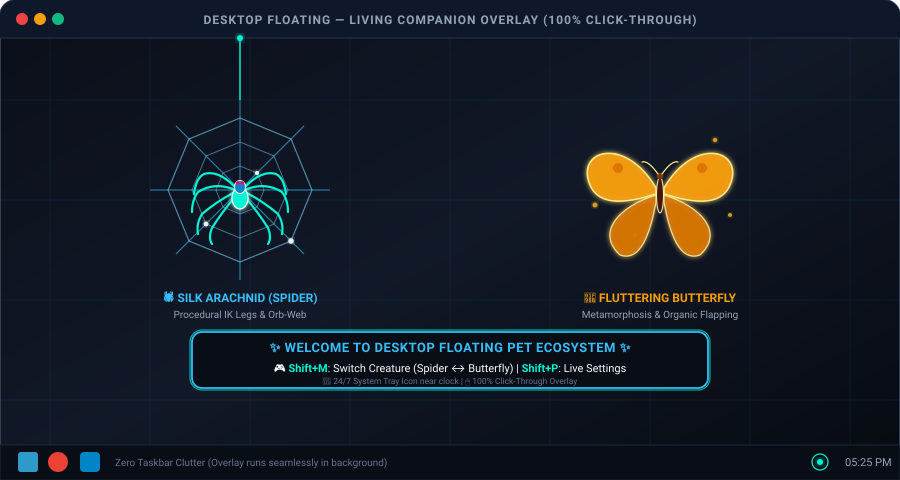

# 🌌 Desktop Floating (ডেস্কটপ ফ্লোটিং — Living Desktop Companions)

<p align="center">
  
  
  
  
  
</p>

An ultra-responsive, physics-driven, living **Desktop Floating Companion Ecosystem** for **Windows 10/11**, **Linux**, and **macOS**. 

Currently featuring the **Procedural Cyber Spider** and the **Graceful Fluttering Butterfly**, with an expanding roadmap of upcoming desktop companions!

The overlay runs seamlessly across your active wallpaper, browser, and games with **100% transparent click-through mechanics (`WS_EX_TRANSPARENT`)**, zero taskbar clutter, 24/7 system tray controls, a sleek dark-glass live settings customizer (`Shift + P`), and an integrated **GitHub Auto-Updater with real-time Megabyte (MB) download progress**!

---

## 🖥️ Visual Desktop Preview (ভিজ্যুয়াল ডেক্সটপ ডেমো)

<p align="center">
  
</p>

> **💡 Zero Desktop Interference**: All companions float effortlessly over your wallpaper, code editors, and YouTube videos without blocking mouse clicks or typing!

---

## 🐾 Living Companions Showcase (প্রাণীসমূহ)

### 🕷️ 1. Silk Arachnid (সাইবার স্পাইডার)
* **Procedural Inverse Kinematics (IK) Legs**: 8 independently calculated jointed legs that grip natural desktop coordinates with realistic stepping phases.
* **Authentic Orb-Web Construction**: Procedural ceiling anchor placement, radial spoke weaving, and concentric spiral thread construction with dewdrop physics.
* **Interactive Hunting & Curiosity**: Playfully crawls toward resting mouse cursors, delivers playful headbutts/shoves, catches flying insects, and performs silk bungee drops (`Shift + B`).

### 🦋 2. Fluttering Butterfly & Caterpillar (প্রজাপতি ও শুঁয়োপোকা)
* **Complete Metamorphosis**: Undulating inchworm caterpillar crawls along screen edges and feeds on fresh leaves.
* **Silky Cocoon Spinning**: Customizable cocoon placement anywhere on your monitor (`Shift + \``).
* **Dual-Winged Flight Physics**: Emerges into an elegant butterfly with smooth, organic flapping aerodynamics and luminous fairy dust stardust trails (`Shift + B`).

### 🔮 3. Upcoming Companions Roadmap (ভবিষ্যতের প্রাণীসমূহ)
* 🦚 **Royal Crested Bird & Chick Nest**: High-altitude nesting, parent-chick nurturing, and return-to-nest flight mechanics.
* 🦎 **Wall Gecko / Chameleon**: Alternating 4-legged creeping gait, panic flee mechanics, and ballistic tongue zaps.
* 💡 **Bioluminescent Fireflies**: Harmonious nighttime floating clusters with biological pulsating glows.
* 🪼 **Deep-Sea Jellyfish**: Translucent bell contraction physics and undulating buoyant tentacles.

---

## ⚡ Highlights & Key Features

- **🚀 100% Standalone Portable `.exe`**:
  - Run immediately on any Windows PC without installing Python, Git, or dependencies!
  - Fully persistent settings (`settings.json` stays alongside the executable).
- **🪟 Clean Taskbar & 24/7 Tray Integration**:
  - The transparent overlay runs with `WS_EX_TOOLWINDOW`—zero taskbar buttons to clutter your taskbar.
  - The Taskbar button only appears while the **Live Settings & Customizer** window is open.
  - Dedicated **Cyber Companion icon** in the Windows System Tray (near the clock) for instant right-click menu controls.
- **🔄 GitHub Live Auto-Updater with MB Counter**:
  - Automatically notifies users when a new release is available on GitHub.
  - Live progress display with exact download metrics: `Downloading: 12.4 MB / 31.2 MB (40%)`.
  - Atomic update application with syntax validation and instant auto-restart.
- **💡 First-Run Guidance & What's New Notifications**:
  - Displays a sleek on-screen cyber card with key shortcuts upon first launch.
  - Automatically shows a "What's New" changelog card whenever a new update is released.
- **🛠️ Interactive Self-Installer (`install.bat`)**:
  - Checks Python, asks user permission before installing packages (`Pillow`, `pystray`), creates Desktop shortcuts with custom cyber icons, and starts the pet.
- **📦 Pip / PyPI Ready**:
  - Installable via `pip install desktop-floating` with instant CLI launch commands: `desktop-floating`, `desktop-float`, and `desktop-spider`.
- **🌐 Dual Multilingual Support**:
  - Complete English & Bengali (বাংলা) localization with on-the-fly language switching and downloader.

---

## 🎮 Hotkeys Quick Reference (কিবোর্ড শর্টকাট)

All hotkeys can be customized inside the **Live Settings Customizer** (`Shift + P`).

| Hotkey | Action (English) | বিবরণ (বাংলা) |
| :--- | :--- | :--- |
| **`Shift + M`** | **Switch Companion Species (Spider ↔ Butterfly)** | **সক্রিয় প্রাণী পরিবর্তন (স্পাইডার ↔ প্রজাপতি)** |
| **`Shift + P`** | **Open Live Settings Customizer** | **লাইভ সেটিংস ও কাস্টমাইজার প্যানেল খুলুন** |
| **`Shift + F`** | **Spawn Prey Fly / Fresh Leaf** | **শিকারযোগ্য উড়ন্ত পোকা / তাজা পাতা তৈরি করুন** |
| **`Shift + B`** | **Bungee Jump (Spider) / Stardust Burst (Butterfly)** | **বাঞ্জি ড্রপ (মাকড়সা) / ফেয়ারি ডাস্ট বিচ্ছুরণ (প্রজাপতি)** |
| **`Shift + T`** | **Cycle Color Themes** | **সাইবার রঙের থিম পরিবর্তন করুন** |
| **`Shift + W`** | **Cycle Model / Wings / Anatomy** | **প্রাণীর শারীরিক গঠন/ডানার স্টাইল পরিবর্তন** |
| **`Shift + \``** | **Relocate Web / Cocoon Anchor** | **মাউস দিয়ে জাল বা কোকুনের অবস্থান পরিবর্তন** |
| **`Shift + C`** | **Restart Entrance Lifecycle** | **নতুন করে সিলিং থেকে নেমে জাল তৈরি শুরু** |
| **`Shift + Q`** | **Set Ceiling Entry Point** | **সিলিং এন্ট্রি পয়েন্ট নির্ধারণ করুন** |
| **`Shift + H`** | **Hatch Spiderling Babies** | **ডিম ফুটে পিঠে মাকড়সার বাচ্চা বের করুন** |
| **`Shift + R`** | **Trigger Instant Health Break** | **স্বাস্থ্য সচেতনতা বিরতি কার্ড প্রদর্শন** |
| **`Shift + S`** | **Toggle Sound Effects (ON/OFF)** | **শব্দ বা সাউন্ড চালু/বন্ধ করুন** |
| **`Shift + ESC`** | **Safely Exit Application** | **অ্যাপ্লিকেশনটি সম্পূর্ণ বন্ধ করুন** |

---

## 📥 Installation & Running (ইনস্টলেশন ও চালনা)

Choose any of the following 4 easy methods:

### Option 1: Standalone Portable `.exe` (Recommended for Any PC)
> **No Python, Git, or command line required!**
1. Download `DesktopFloatingSpider.exe` from the [Releases](https://github.com/sohaghaldar/Desktop_floating-v1form/releases) page (or `Desktop-Floating-Spider-v2.6.0-Portable.zip`).
2. Double-click `DesktopFloatingSpider.exe` to run immediately!
3. All your customized settings are automatically saved in `settings.json` next to the executable.

---

### Option 2: Install via `pip`
Install directly into your Python environment as a standard CLI package:

```bash
pip install desktop-floating
```

Launch anywhere from CMD / PowerShell / Terminal:
```bash
desktop-floating
# or
desktop-float
# or
desktop-spider
```

---

### Option 3: Interactive Installer (`install.bat`)
1. Clone or download this repository.
2. Double-click **`install.bat`** (or run `python setup_interactive.py` in CMD).
3. The interactive installer will:
   - Check your Python environment.
   - Ask permission to install required packages (`Pillow`, `pystray`).
   - Create a desktop shortcut with a cyber icon.
   - Launch Desktop Floating in the background!

---

### Option 4: Traditional Source Run
```bash
# Install dependencies
pip install -r requirements.txt

# Run silently in background (Windows)
run_spider.bat
# or
pythonw desktop_spider.py
```

---

## ⚙️ Configuration & Customization (`settings.json`)

All settings persist in `settings.json`. You can modify them directly from the in-app **Live Settings Control Panel** (`Shift + P`) or manually in the JSON file:

```json
{
  "LANGUAGE": "en",
  "CREATURE_SPECIES": "spider",
  "SPIDER_MODEL_INDEX": 0,
  "SPIDER_SIZE_SCALE": 0.5,
  "SPIDER_SPEED": 6.0,
  "THEME_INDEX": 1,
  "BUTTERFLY_THEME_INDEX": 0,
  "SOUND_ENABLED": false,
  "BUNGEE_AUTO_ENABLED": true,
  "HOTKEYS": {
    "SPECIES": "Shift+M",
    "SETTINGS": "Shift+P",
    "BUG": "Shift+F",
    "BUNGEE": "Shift+B"
  }
}
```

---

## 🔄 Built-in GitHub Auto-Updater

Desktop Floating includes a native updater engine:
1. When you open the Settings panel (`Shift + P`), it silently queries the latest GitHub release.
2. If an update is available, you will see a notification and the **Update Now** button will illuminate.
3. Clicking **Update Now** downloads the release with a **live MB counter** (`Downloading: 12.4 MB / 31.2 MB (40%)`).
4. Once verified, it applies the update atomically and seamlessly restarts the application.

---

## 🤝 Contributing

Contributions, bug reports, and pull requests are warmly welcomed!
- Fork the repository.
- Create a new feature branch (`git checkout -b feature/CoolNewFeature`).
- Commit your improvements (`git commit -m "Add CoolNewFeature"`).
- Push to the branch (`git push origin feature/CoolNewFeature`).
- Open a Pull Request on GitHub.

---

## 📄 License & Credits

- **Author**: Sohag Haldar ([@sohaghaldar](https://github.com/sohaghaldar))
- **Project**: Pompom — Desktop Floating Living Cyber Pet Ecosystem
- **License**: Released under the **MIT License**. Free for personal and educational use.
